<br />

I've spent 6+ years building web apps that stay maintainable as they grow. I take real operational problems, mostly around **documents and storage**, and turn them into software, shipping in small increments and keeping the business involved throughout.

<br />

## Currently building

Document-processing tools in **Go**, with **[ent](https://entgo.io)** as the data layer. Each stage is its own tool, so it can run alone or as part of a pipeline.



<table>
<tr>
<td width="33%" valign="top">

**Compression**<br />
<sub>Shrink PDFs and scans while keeping text readable.</sub>

</td>
<td width="33%" valign="top">

**OCR**<br />
<sub>Pull searchable text out of scanned documents.</sub>

</td>
<td width="33%" valign="top">

**Metadata**<br />
<sub>Read, normalize and render document metadata.</sub>

</td>
</tr>
</table>

<br />

## What I build

<table>
<tr>
<td width="50%" valign="top">

**Document Management Systems**

<sub>
Upload and versioning<br />
Metadata, tagging and full-text search<br />
Approval workflows<br />
Role-based access and audit trails
</sub>

</td>
<td width="50%" valign="top">

**Storage Management**

<sub>
File organization and quotas<br />
S3-compatible object storage<br />
Retention and lifecycle policies<br />
Secure, expiring share links
</sub>

</td>
</tr>
</table>

<br />

## How I work

<table>
<tr>
<td width="80" valign="top"><code>01</code></td>
<td valign="top">

**Feature slicing + hybrid DDD**<br />
<sub>Code is grouped by feature, not by layer, and each slice owns its UI, logic and data. I apply DDD (bounded contexts, entities) only where the domain is complex enough to need it.</sub>

</td>
</tr>
<tr>
<td valign="top"><code>02</code></td>
<td valign="top">

**Lean development**<br />
<sub>Build the smallest useful thing, get feedback, iterate. No speculative features.</sub>

</td>
</tr>
<tr>
<td valign="top"><code>03</code></td>
<td valign="top">

**No big-bang releases**<br />
<sub>Ship small slices that each deliver value, deploy safely and roll back easily.</sub>

</td>
</tr>
<tr>
<td valign="top"><code>04</code></td>
<td valign="top">

**Lean management**<br />
<sub>Short feedback loops, visible work and continuous improvement with the team.</sub>

</td>
</tr>
</table>

<br />

## Next.js in practice

```
App Router · Server Components · Server Actions
Route Handlers + middleware for auth and access control
Large uploads via presigned URLs and streaming
SSR / SSG / ISR with deliberate caching
End-to-end TypeScript
```

<br />

## Stack

<table>
<tr>
<td width="120" valign="top"><sub><b>FRONTEND</b></sub></td>
<td>


</td>
</tr>
<tr>
<td valign="top"><sub><b>BACKEND</b></sub></td>
<td>


</td>
</tr>
<tr>
<td valign="top"><sub><b>DATABASE</b></sub></td>
<td>


</td>
</tr>
<tr>
<td valign="top"><sub><b>INFRA</b></sub></td>
<td>


</td>
</tr>
</table>

<br />

## Activity

<p>


</p>

<br />

## Contact

[](https://www.linkedin.com/in/farid-aiman-mohamed-ali/)
[](https://github.com/ifaridaiman)
